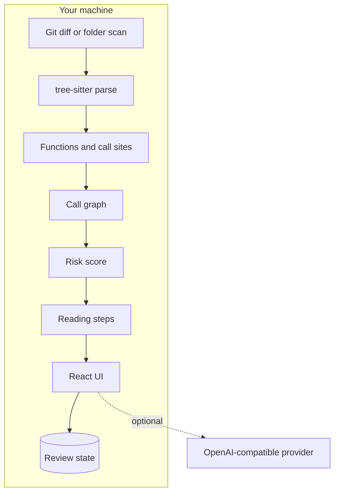

<div align="center">
  
  <h1>Grasp</h1>
  <p><strong>Understand code changes before you merge them.</strong></p>
  <p>Grasp is a local-first desktop app that turns a diff into a reviewable map of functions, calls, and risk — so you can read a change in the order that matters.</p>
  <p>
    
    
    
    
  </p>
</div>

[Features](#features) · [How it works](#how-it-works) · [Quick start](#quick-start) · [Using Grasp](#using-grasp) · [AI](#ai-optional) · [Architecture](#architecture) · [Troubleshooting](#troubleshooting) · [Development](#development)

## Why Grasp

A diff tells you which lines changed. It does not tell you which behavior changed, what depends on it, or where a bug would be most expensive.

Grasp closes that gap. It parses the change into functions, compares their structure before and after, links calls into a graph, and ranks every node by risk. The result is a short, ordered walkthrough — deterministic by default, with AI available when you want a written explanation.

## Features

| Capability | What it gives you |
| --- | --- |
| **Structure-aware diff** | Parses changed files into functions and modules, then compares signature, calls, exits, and complexity before and after. |
| **Risk-ranked walkthrough** | Groups connected changes into ordered steps — riskiest first, callers before callees. No model required. |
| **Call graph** | Shows added, removed, and unchanged calls, plus unchanged callers for context. |
| **Review memory** | Mark nodes understood or flagged. Marks are tied to content hashes and expire when the code changes. |
| **Optional AI** | Streamed plain-English explanations for the selected code, and a written walkthrough with a summary and per-step rationale. |
| **Local-first** | Diffing, parsing, scoring, and review state stay on your machine. AI requests go only to the provider you configure. |

## How it works



1. **Collect** the change: branch diff, uncommitted work, or a folder scan when there is no repository.
2. **Parse** each file into functions, modules, and call sites with tree-sitter.
3. **Link** calls into a graph using name and qualifier heuristics.
4. **Score** each changed node from 0–100 and assign a risk tier.
5. **Group** connected changes into a reading order.
6. **Review** in the map, inspector, and walkthrough.

<details>
<summary><strong>How risk is scored</strong></summary>

Risk is a 0–100 score. Weights favor what makes a bug expensive over raw size.

| Signal | Weight | Notes |
| --- | --- | --- |
| Sensitive sinks | 30% | Money, auth, persistence, or network code. |
| Callers | 20% | Log-scaled call-site count. |
| Complexity | 20% | Cyclomatic complexity. |
| Missing tests | 20% | Counted only when tests apply to the node. |
| Changed lines | 10% | Log-scaled added and removed lines. |

Tiers: **Critical** 65+, **High** 45–64, **Medium** 20–44, **Low** below 20.

</details>

## Quick start

**Requirements:** Node.js 22+, pnpm 10, and Git (optional).

```bash
corepack enable
pnpm install
pnpm dev
```

Build and preview the production bundle:

```bash
pnpm build
pnpm start
```

| Command | What it does |
| --- | --- |
| `pnpm dev` | Start Electron with renderer hot reload. |
| `pnpm build` | Type-check and bundle main, preload, and renderer into `out/`. |
| `pnpm start` | Preview the production bundle. |
| `pnpm typecheck` | Run `tsc --noEmit`. |

The repository pins pnpm 10.32.1 through `packageManager`. Installer packaging is not configured yet; `pnpm build` produces the bundled app in `out/`.

## Using Grasp

1. **Open a project.** Recent projects are listed on the welcome screen.
2. **Choose the scope.** In a git repository, switch between **Branch** (merge-base with the default branch) and **Uncommitted** (HEAD). Outside git, Grasp scans the folder. Branch mode on the default branch falls back to uncommitted changes.
3. **Read the walkthrough.** The left panel orders the steps; the center shows the current step's call graph; the right inspector explains the selected node.
4. **Record your review.** Mark **Understood** or **Flag for author**. Grasp remembers state per project.

| Area | What it shows |
| --- | --- |
| **Walkthrough** | Ordered steps, progress, and the optional AI story. |
| **Map** | The current step plus its immediate callers and callees, with risk color, change tag, review state, and untested badge. |
| **Inspector** | Structural before/after, risk breakdown, AI explanation, and code. |
| **Status bar** | Node, critical, and untested counts; review-time estimate; skipped files. |

On the map, green edges are new calls, red dashed edges are removed calls, and gray edges are unchanged. Ghost cards are unchanged code kept for context.

| Shortcut | Action |
| --- | --- |
| `J` / `K` | Next / previous node |
| `U` | Toggle understood |
| `F` | Toggle flagged |
| `Esc` | Clear selection |
| `⌘ R` | Re-analyze (macOS) |

## AI (optional)

Grasp works without AI. To enable it, add an OpenAI-compatible provider in **Settings → AI providers**:

- **Ollama** — `http://localhost:11434/v1`, fully local.
- **Custom gateway** — any OpenAI-compatible base URL, usually ending in `/v1`.

Two actions use the model:

- **Analyze** in the inspector: a plain-language explanation of the selected code, including diff context and callers/callees.
- **Write story with AI** in the walkthrough: a summary and a reviewer-ordered set of steps for the whole change.

API keys are encrypted with the OS keychain. When Grasp fetches a model list, a saved key is only sent to the URL it was saved for. AI output is labeled **unverified**; nothing is executed.

## Architecture

| Path | Responsibility |
| --- | --- |
| `src/main` | Electron main process: git, diff parsing, tree-sitter, call linking, risk, steps, AI client, persistence, IPC. |
| `src/preload` | Context-isolated bridge exposing the typed `window.lens` API. |
| `src/renderer` | React UI: workspace, React Flow graph, inspector, walkthrough, settings. |
| `src/shared` | Shared types and the IPC contract. |

**Privacy and security**

- No telemetry. Grasp does not collect analytics or usage data.
- Code leaves your machine only when you explicitly run an AI action, and only to the provider you configured.
- The renderer is sandboxed: `sandbox` and `contextIsolation` on, `nodeIntegration` off. It never touches the filesystem or network directly.
- Every IPC payload is validated with Zod. Folder roots must be opened through the native picker, and file reads are checked to stay inside the project.
- API keys use Electron `safeStorage`; settings and review state are JSON in Electron's user data directory.
- Navigation is blocked; external links open in the system browser.

## Supported languages

| Language | Extensions |
| --- | --- |
| TypeScript | `.ts`, `.mts`, `.cts`, `.tsx` |
| JavaScript | `.js`, `.mjs`, `.cjs`, `.jsx` |
| Python | `.py` |
| Go | `.go` |
| Rust | `.rs` |
| Java | `.java` |
| C# | `.cs` |
| C / C++ | `.c`, `.h`, `.cc`, `.cpp`, `.cxx`, `.hpp`, `.hh` |
| Ruby | `.rb` |
| PHP | `.php` |
| Swift | `.swift` |
| Kotlin | `.kt`, `.kts` |

## Limits

- **Call edges are heuristic.** Calls are matched by name, language family, and qualifier; dynamic dispatch and same-named functions can mislink.
- **Static analysis only.** Grasp never executes code, runs tests, or performs mutation testing.
- **File caps.** Up to 5,000 files per analysis; files over 1 MB, binaries, and minified files are skipped.
- **Sinks are keyword-based.** Money, auth, persistence, and network signals come from code patterns, not data flow.
- **AI can be wrong.** Model output is unverified and never treated as fact.
- **Local only.** Grasp does not post comments, approve merges, or integrate with a code host.

## Troubleshooting

- **Ollama is unreachable.** Make sure Ollama is running and the model is pulled: `ollama serve` and `ollama pull <model>`. Use the base URL `http://localhost:11434/v1`.
- **API keys cannot be saved.** Electron's secure storage needs an OS keyring. On Linux, install a Secret Service provider such as GNOME Keyring or KWallet, or use a local provider that needs no key.
- **No changes are shown.** In branch mode on the default branch, Grasp reviews uncommitted changes only. Commit something or switch to **Uncommitted**.

## Development

```bash
pnpm dev        # Electron + renderer hot reload
pnpm typecheck  # Strict TypeScript, no emit
pnpm build      # Typecheck + production bundle
pnpm start      # Preview the production bundle
```

- Keep IPC changes in sync with `src/shared/types.ts`.
- Before submitting a change, run `pnpm typecheck && pnpm build`.
- The repository has no automated test suite yet; verify the affected flow manually.

### Contributing

Keep changes focused, explain the user-visible behavior, and run the checks above before opening a pull request.

## License

Grasp is a private project. No license is granted for redistribution or reuse.

## Acknowledgements

Built with [Electron](https://www.electronjs.org), [React](https://react.dev), [TypeScript](https://www.typescriptlang.org), [tree-sitter](https://tree-sitter.github.io/tree-sitter/), [React Flow](https://reactflow.dev), and [Zod](https://zod.dev).
